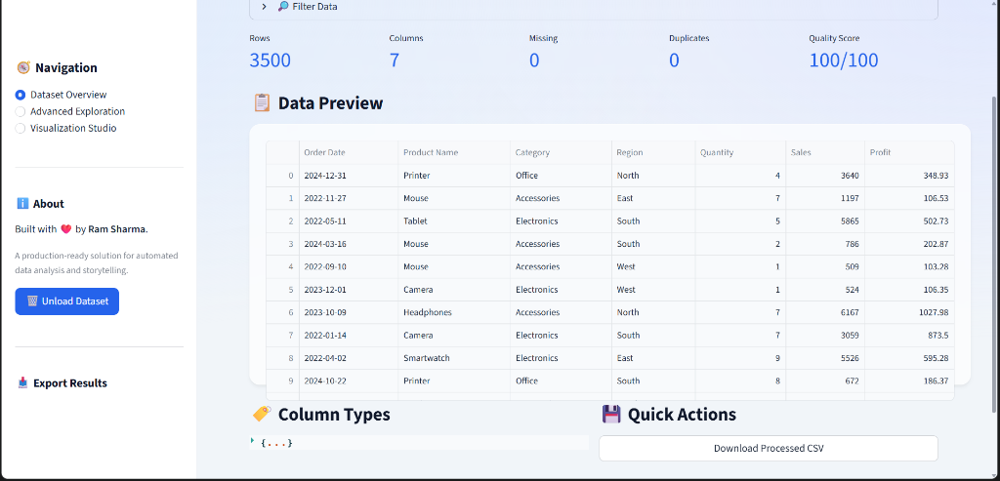

# DataViz: The Analytics Powerhouse 📊

> **Production-Grade Data Storytelling Platform**  
> *Built by Ram Sharma*

   

**DataViz** is a next-generation analytics suite designed to bridge the gap between simple dashboards and complex BI tools. It combines AI-driven insights, 3D visualization, and automated statistical testing into a single, high-performance interface.

---

## 🌟 Why DataViz?

### 1. Visualization Studio 2.0 (The "Unreal" Engine) 🎨
Stop settling for basic charts. DataViz offers a dedicated studio for creating publication-ready visuals:
- **Hierarchical Analysis**: Drill down into data with interactive **Sunburst Charts** and **Treemaps**.
- **Density & Heatmaps**: Visualize hotspots with **2D Density Contours** and **Hexbin Heatmaps**.
- **4D Scatter Plots**: Analyze 4 dimensions at once: X, Y, Size, Color, plus **Time Animation**.
- **Smart Faceting**: Instantly split any chart into a grid of sub-plots (Trellis display) by category.

### 2. Deep Dive Analytics 🧠
Go beyond surface-level metrics with a built-in statistical engine:
- **🏥 Data Quality Lab**: Visual "Missing Matrix" to spot nullity patterns instantly.
- **🧪 Normality Testing**: Auto-calculates D'Agostino's K^2 test and Shapiro-Wilk to check for Gaussian distributions.
- **🔗 Target Analysis**: Select a target, and the engine ranks every other feature by correlation strength.
- **📈 Time Series Hub**: Auto-detects dates to visualize trends, rolling averages, and seasonality.
- **🧬 PCA Structure**: Projects high-dimensional data into 3D Space using Principal Component Analysis.

### 3. Engineered for Performance ⚡
- **3G-Ready**: Smart downsampling ensures charts load instantly even on slow mobile networks (max 5k points per plot).
- **Aggressive Caching**: Heavy computations (Correlation, PCA) are computed once and cached.
- **Stress Tested**: Verified to handle **100,000+ rows** with sub-second interaction headers.

---

## 🚀 Getting Started

### Installation
```bash
git clone https://github.com/yourusername/dataviz.git
cd dataviz
pip install -r requirements.txt
```

### Usage
```bash
streamlit run main.py
```
1.  **Upload**: Drag & drop CSV, Excel, or JSON.
2.  **Explore**: Use the "Deep Dive" tab for statistical rigor.
3.  **Create**: Use "Visualization Studio" to build and export standard charts.

---

## 📸 Screenshots

| **Visualization Studio 2.0** | **Deep Dive Analytics** |
|:---:|:---:|
| Create complex Sunbursts & Treemaps | Normality Tests & Missing Matrices |
|  | *(Add Analytics Screenshot Here)* |

---

## 🛠️ Tech Stack
-   **Frontend**: Streamlit, Custom CSS (Glassmorphism), Google Fonts (Inter)
-   **Viz Engine**: Plotly Express (Interactive, WebGL-accelerated)
-   **Backend**: Pandas, Scikit-Learn (PCA), Scipy (Stats)

---

*© 2026 Ram Sharma. All Rights Reserved.*
