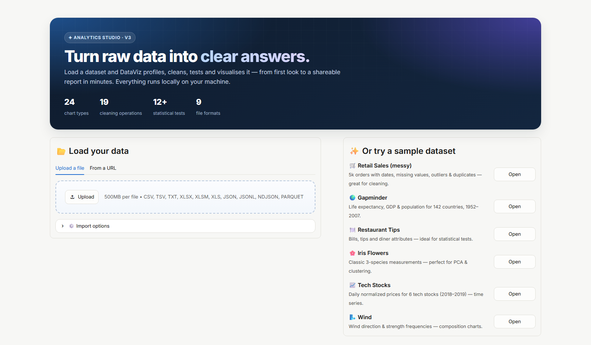
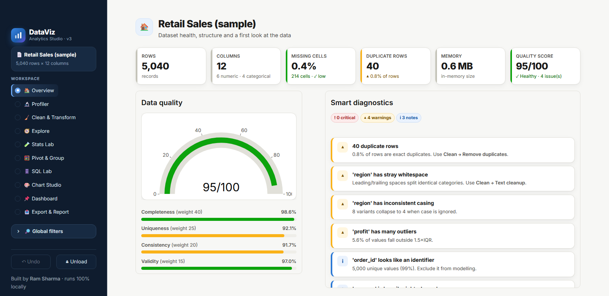
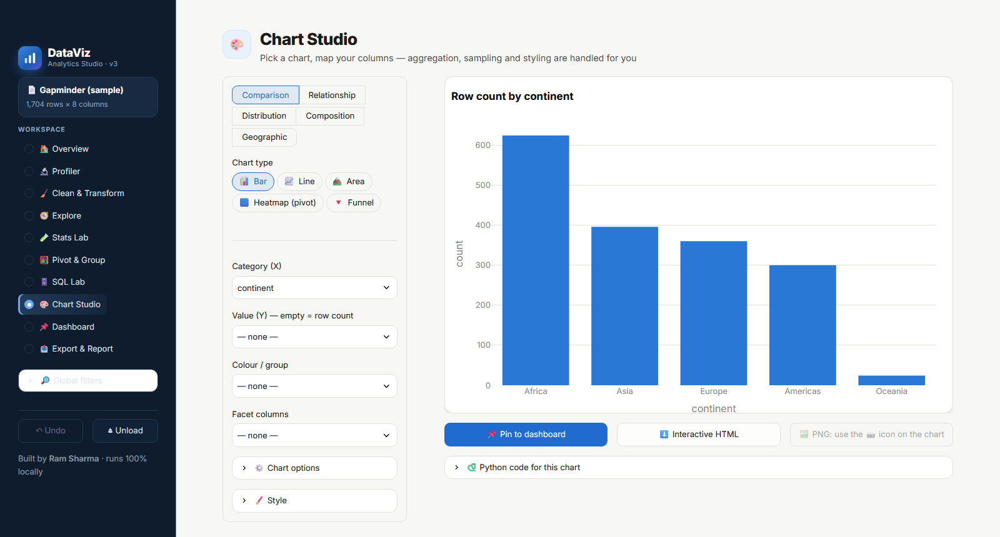

# DataViz — Analytics Studio 📊

> From raw file to clean data, statistical answers and shareable charts — in one local app.
> *Built by Ram Sharma*

   



DataViz is a no-code analytics workbench built on Streamlit, pandas, Plotly, SciPy and scikit-learn.
Load a dataset and it profiles, diagnoses, cleans, tests and visualises it. Everything runs on your
machine, so your data never leaves it.

---

## ✨ What's inside

| Page | What it does |
|---|---|
| 🏠 **Overview** | Status-coded health tiles, a 4-dimension **quality score** (completeness, uniqueness, consistency, validity), smart diagnostics, schema with completeness bars, searchable preview, summary stats |
| 🔬 **Profiler** | Deep single-column profile (percentiles, normality, top values, date patterns) + small-multiple distributions of every numeric column |
| 🧹 **Clean & Transform** | 19 no-code operations: impute, drop blanks/duplicates, outlier handling (IQR / Z / MAD), type conversion, text cleanup, find & replace, formulas, binning, log/z-score/min-max, date parts, one-hot, split, sort, sample. **Preview before apply, full undo**, and the whole pipeline exports as a **runnable pandas script** |
| 🧭 **Explore** | Missing-value map & missingness correlation · distributions with Q-Q plots and 4 normality tests · Pearson / Spearman / Kendall heatmaps with clustering · Cramér's V for categories · **driver analysis** (what explains a target?) with mutual information · outliers incl. Isolation Forest · **time series** with resampling, rolling means, % change, seasonality heatmap and seasonal decomposition · **PCA** (scree, loadings) · **K-Means clustering** with elbow/silhouette and cluster fingerprints |
| 🧪 **Stats Lab** | Pick a question; DataViz runs the right tests (Welch t, Mann-Whitney, ANOVA, Kruskal-Wallis + Tukey HSD, χ², Pearson/Spearman/Kendall, one-sample, paired) and explains the answer **in plain English with effect sizes** |
| 🧮 **Pivot & Group** | Pivot tables with totals, % of total/row/column, heatmap colouring; multi-metric group-bys; CSV/Excel export |
| 🗄️ **SQL Lab** | DuckDB SQL over your data (window functions, `QUALIFY`, date functions…) with example queries, quick charts and "use result as dataset" |
| 🎨 **Chart Studio** | **24 chart types** across 5 families: automatic aggregation, Top-N + "Other", sampling for big data, trendlines, marginals, facets, animation, maps, choropleths. Every chart exports as interactive HTML, PNG, **and the Python code that reproduces it** |
| 📌 **Dashboard** | Pin charts from the Studio; they re-render live with your filters. Reorder, change the layout, export as one HTML page, save and load layouts as JSON |
| 📤 **Export & Report** | CSV / Excel / Parquet / JSON, a self-contained **interactive HTML report** or Markdown report, and the reproducible pipeline script |

**Across the whole app**
- **Global filters** (ranges, date ranges, values, exclude, keep blanks) apply to every analysis page.
- **Smart ingestion:** CSV/TSV/TXT (delimiter and encoding auto-detected), Excel with sheet picker, JSON / JSON Lines (nested records flattened), Parquet, and URLs (GitHub links work). Numbers stored as text (`$1,200`, `45%`) and dates stored as text are converted automatically; leading-zero codes like ZIPs stay as text.
- **Six sample datasets**, including a deliberately messy retail dataset for trying the cleaning tools.
- **Deep links:** `http://localhost:8501/?sample=gapminder&page=Explore`

## 🎨 Design system

The UI follows a single design system. Colour carries meaning, not decoration:

- **One brand accent** (blue) for interactive elements, on a warm-neutral canvas with a deep-navy sidebar.
- **Status colours are reserved** for meaning (green = healthy, amber = needs attention, red = critical) and always pair with an icon and a label (✓ ▲ !), so colour is never the only signal.
- **Column kinds keep fixed identity colours** (numeric, category, date, text, boolean) on every page.
- **Charts use a colour-blind-aware categorical palette** in a validated order. Magnitude uses a single-hue blue ramp, polarity uses a blue ↔ red scale with a neutral grey midpoint, and a category keeps its colour across charts.
- **All text meets WCAG AA contrast** (≥ 4.5:1), including secondary text and chart axis labels.

| Overview | Chart Studio |
|:---:|:---:|
|  |  |

## 🚀 Getting started

```bash
git clone https://github.com/yourusername/dataviz.git
cd dataviz
python -m venv .venv
# Windows: .venv\Scripts\activate    macOS/Linux: source .venv/bin/activate
pip install -r requirements.txt
streamlit run main.py
```

Then open http://localhost:8501, drop in a file (or open a sample), and start from **Overview**.

## 🧪 Tests

```bash
python -m pytest tests -q          # 121 tests: engine unit tests + every page × every sample dataset
python tests/stress_test.py 100000 # performance benchmark
```

The engine tests also check that every cleaning step's generated pandas code reproduces exactly
the same result as the app.

## 🗂️ Project structure

```
main.py                  App entry: page config, sidebar, navigation, global filters, deep links
.streamlit/config.toml   Theme (design tokens, fonts, sidebar, status colours)
assets/style.css         Component styles (tiles, badges, insight cards, hero…)
src/
  loader.py              File / URL / sample ingestion + type inference
  preprocess.py          Column classification, summary, quality score
  eda.py                 Statistics & ML engine (insights, correlations, drivers, PCA, clustering, time series)
  stats_tests.py         Hypothesis tests with plain-English verdicts
  transforms.py          Cleaning operations → (data, label, pandas code)
  visuals.py             Plotly template, palettes, spec-driven chart builder with code export
  report.py              HTML & Markdown reports
  state.py               Session state, undo stack, filters, dashboard pins
  ui_components.py       Reusable UI components
  views/                 One module per page (home, overview, profiler, clean, explore, …)
tests/                   pytest suites + stress benchmark
```

## ⚡ Performance

Heavy computations are cached. Point-based charts sample down to 10k points (adjustable) and render
with WebGL, and aggregated charts always use the full data. On 100k rows, a first (uncached)
PCA takes about 1 s and K-Means about 1.7 s. Everything else takes well under half a second.

---

*© 2026 Ram Sharma. All Rights Reserved.*
